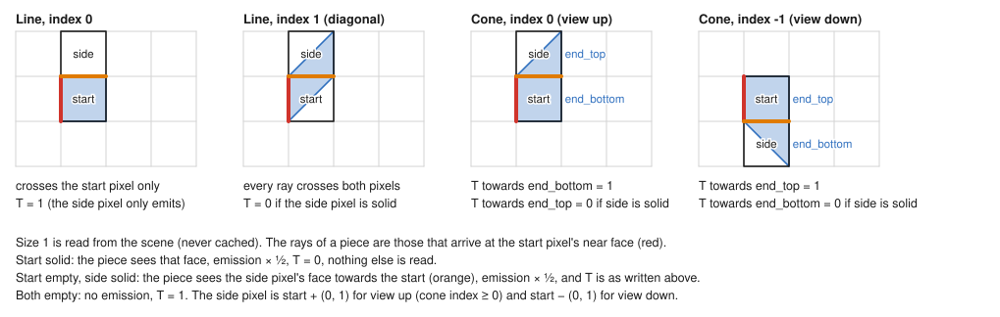
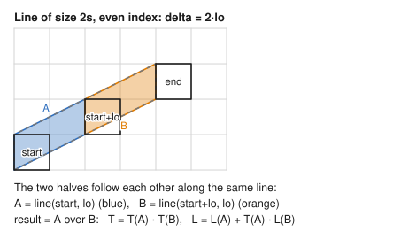
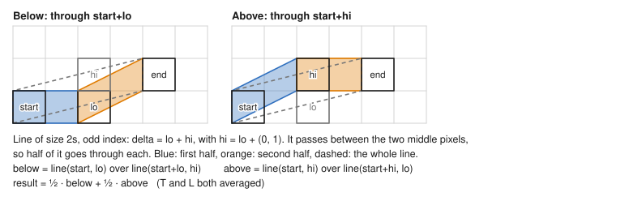
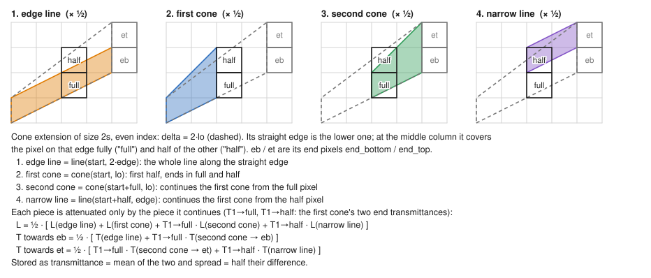
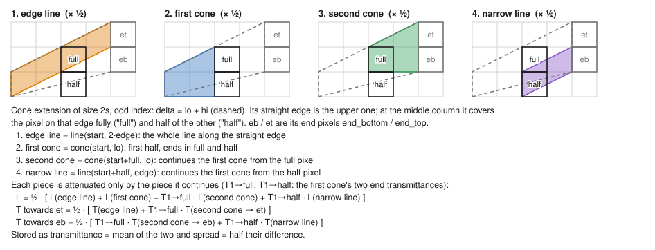
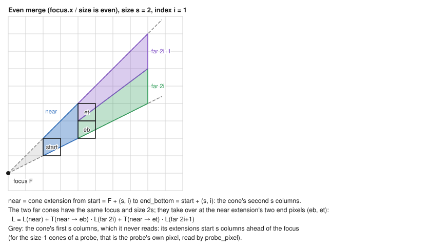
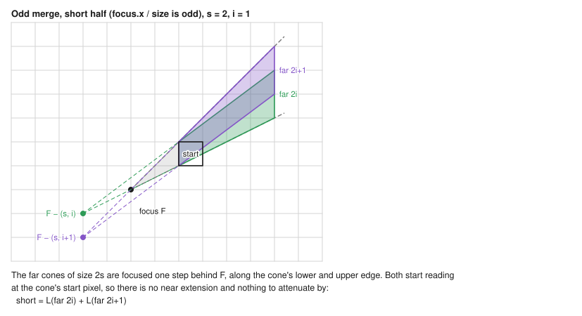
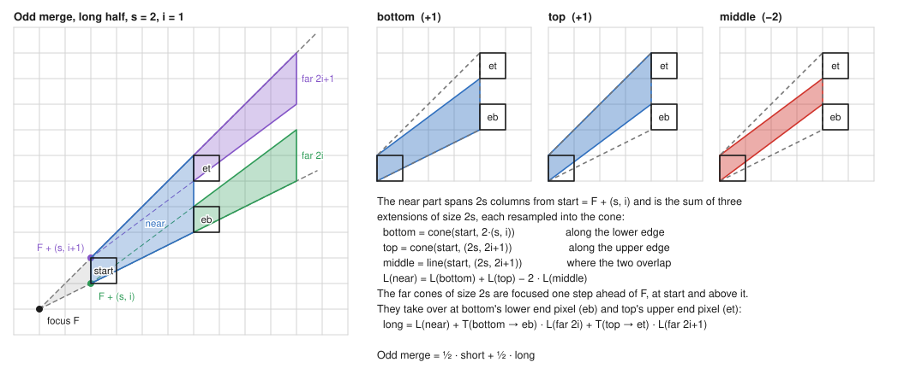

# Extension merging modes

How the `--ext` renderer puts radiance together, one diagram per mode. The diagrams are drawn from the renderer's own
shapes by `unchecked_tests/tests/ext_diagrams.rs`; regenerate them with

```
cargo test --release -p unchecked_tests --test ext_diagrams
```

Conventions: a pixel `p` is the unit square from `p` to `p + (1, 1)`; y points up, so "bottom" and "top" are as in the
code. `T` is transmittance, `L` radiance. An extension of delta `(size, index)` runs from the near (left) face of its
start pixel to the near face of its end pixel(s): a line stays one pixel wide, a cone widens from one pixel to two
(`end_bottom`, `end_top`).

There are two layers:

- **Extensions** (`get_extension`, `src/extension.rs`): the fluence (`T` and `L`) of a line or cone extension of size
  2s is built from extensions of size s (a cone also uses the size-2s line along its straight edge). Modes 1–5.
- **Cones** (`get_radiance_recursive_ext`, `src/render/ext.rs`): the radiance of a cone of size s is its near
  extension(s) plus cones of size 2s. Modes 6–8.

## Extensions

### 1. Size 1 (leaf)



### 2. Line, even index



### 3. Line, odd index



### 4. Cone, even index



### 5. Cone, odd index

The mirror image of the even case: the straight edge is the upper one.



## Cones

A cone of size s and index i with focus F is even or odd by the parity of `F.x / s`. Its extensions start at
`start = F + (s, i)`. The examples use s = 2, i = 1.

### 6. Even merge



With `simplify_occlusion` set, both far cones are multiplied by the near extension's mean transmittance instead of
the per-end values.

### 7. Odd merge, short half



### 8. Odd merge, long half



The odd merge is the mean of the two halves: `½ · short + ½ · long`.

## The probe

Each probe sums 8 size-1 cones: indices −1 and 0 in each of the 4 rotations of the scene. The pixel a cone crosses
first, `focus + (0, index)`, touches the probe and is read directly (`probe_pixel`): if it is solid the cone sees only
its emission, otherwise the cone's radiance is merged as above.
